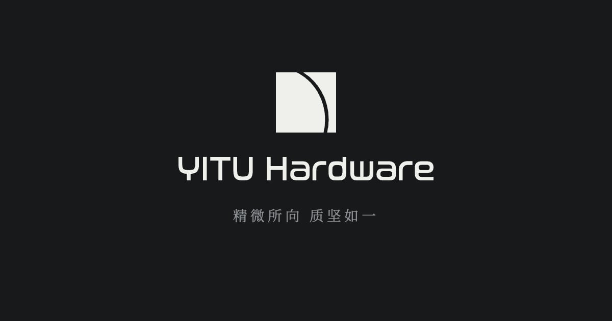

# YITU Hardware · 怡途五金



A bilingual website for a precision CNC machining business, combining an industrial visual identity, an interactive 3D Hero and clear presentation of services, processes and capabilities.

面向精密 CNC 加工企业的中英文网站设计与开发项目。以克制的留白、金属质感和清晰的信息层级，展示行业应用、工艺、加工能力、合作保障与联系渠道。

## Design and interaction

- Interactive Spline Hero on desktop; a clean static background on mobile.
- Bottom-aligned Hero copy with a scroll-driven upward mask.
- Craft steps with synchronized click / scroll selection and soft image crossfades.
- Chinese / English switching and responsive navigation.
- Contact information, WeChat and a quote form that opens the customer's email draft for adding drawings and sending.
- Local fonts and images; static HTML, CSS and JavaScript output.

## Role and process

The project owner led business requirements, content decisions and visual direction, collaborating with AI on frontend implementation, motion adjustments, responsive layouts and debugging.

作者主导业务需求、内容取舍与视觉方向，与 AI 协作完成前端实现。项目经验包括根据观看反馈调整动画、为手机选择静态背景，以及同步检查中英文版式。

[项目经验 · Notion](https://app.notion.com/p/3f915452b84481d981b8d39ed184faa1?pvs=204)

## Stack

Next.js 16 · React 19 · TypeScript · Tailwind CSS 4 · GSAP · Spline · Zustand.

## Run locally

Use a current Node.js 22 release (at least 22.22.2).

```bash
npm ci
npm run dev
```

Checks: `npm run lint`, `npm run build`, `npm run typecheck`. Static output: `out/`.

Source, public assets, configuration and package-lock.json belong in this repository. node_modules, .next and out are generated locally.

## Project notes

Desktop, 375px and 768px Chinese / English browser smoke checks pass, along with lint, build and typecheck. Installation and build from a clean temporary source directory also pass. Real-device testing remains pending. There is no published site URL yet.

Brand assets and company copy belong to their respective owners. Third-party dependency, font and asset licenses remain applicable. No project-wide open-source license has been selected.
